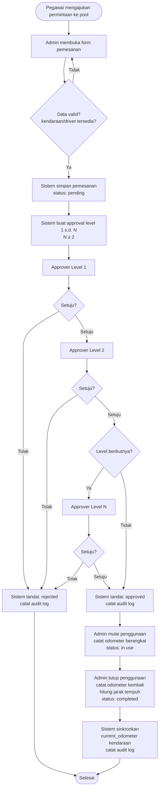
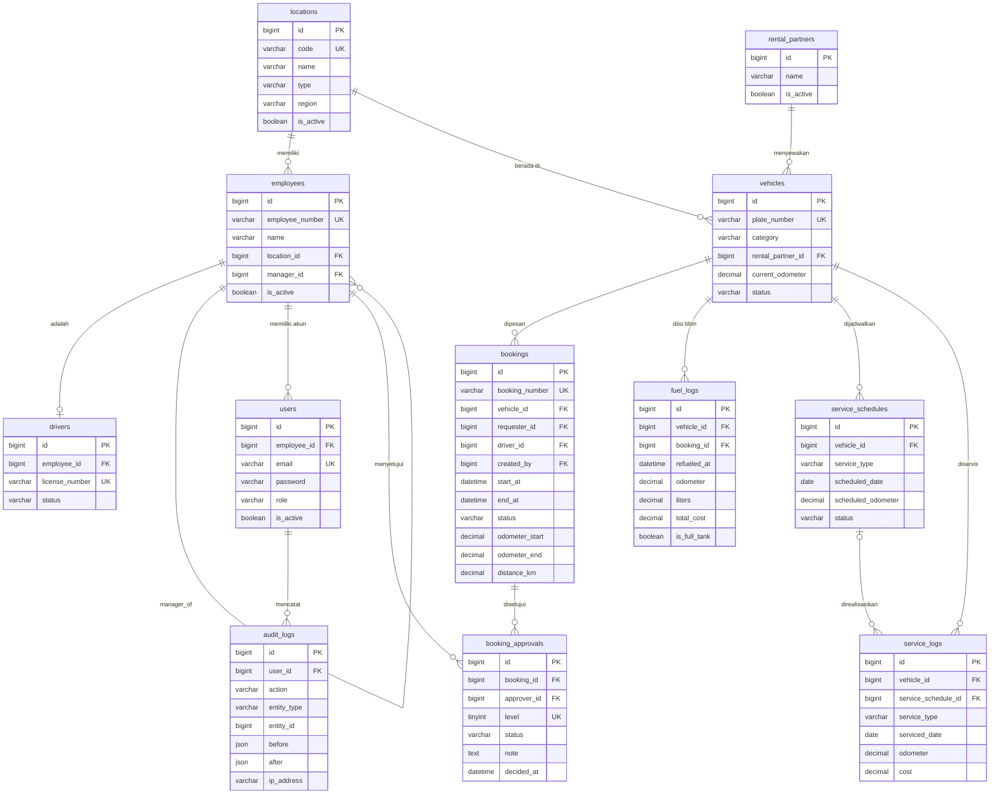

# TransOps — Fleet Booking & Monitoring System

<p align="center">
  
</p>

Aplikasi web manajemen pemesanan kendaraan, persetujuan berjenjang, dan monitoring armada (konsumsi BBM, jadwal service, riwayat pemakaian) untuk perusahaan tambang nikel dengan 1 kantor pusat, 1 kantor cabang, dan 6 tambang.

Dibangun sebagai pemenuhan Technical Test — Engineer Lead.

---

## Daftar Isi

1. [Informasi Teknis](#informasi-teknis)
2. [Fitur](#fitur)
3. [Kredensial Akun](#kredensial-akun)
4. [Persyaratan Sistem](#persyaratan-sistem)
5. [Instalasi & Menjalankan](#instalasi--menjalankan)
6. [Panduan Penggunaan](#panduan-penggunaan)
7. [Diagram](#diagram)
8. [Struktur Proyek](#struktur-proyek)
9. [Dokumentasi Terkait](#dokumentasi-terkait)

---

## Informasi Teknis

| Komponen | Versi / Teknologi |
|---|---|
| **Framework** | Laravel 13 (`laravel/framework ^13.17`) |
| **Frontend** | Inertia.js 3, React 19, TypeScript 5, Tailwind CSS 4, shadcn/ui |
| **PHP** | ^8.3 (teruji pada 8.4) |
| **Database** | SQLite 3 (default lokal) · MySQL 8 (siap produksi) |
| **Export Excel** | maatwebsite/excel ^3.1 |
| **Statistik & Grafik** | Recharts |
| **Auth** | Laravel Fortify (session, bcrypt, 2FA, verifikasi email) |

### Stack Lengkap

- **Backend:** PHP 8.3+, Laravel 13, Laravel Fortify
- **Frontend:** React 19, Inertia.js 3, Tailwind CSS 4, shadcn/ui
- **Database:** SQLite (development), MySQL 8 (production)
- **Tooling:** Vite 8, Pint (code style), PHPUnit 12, ESLint, Prettier

---

## Fitur

1. **Autentikasi & RBAC** — 2 peran (`admin`, `approver`); akses lintas peran diblokir di sisi server.
2. **Pemesanan Kendaraan** — admin menginput pemesanan, memilih kendaraan, driver, dan approver berjenjang (minimal 2 level); proteksi double-booking; nomor `BK-YYYYMM-NNNN` otomatis.
3. **Persetujuan Berjenjang** — approver menyetujui/menolak melalui aplikasi; level N hanya dapat diproses setelah level N-1 disetujui.
4. **Penggunaan & Penyelesaian** — pencatatan odometer berangkat/kembali, perhitungan jarak tempuh, sinkronisasi odometer kendaraan.
5. **Monitoring BBM** — pencatatan pengisian (liter, harga, odometer, full-tank) dan perhitungan konsumsi km/liter.
6. **Monitoring Service** — jadwal service (due/overdue) dan riwayat service (termasuk perbaikan ad-hoc).
7. **Dashboard** — grafik pemakaian kendaraan per bulan + ringkasan statistik armada.
8. **Laporan Excel** — export laporan pemesanan periodik dengan filter rentang tanggal.
9. **Audit Log** — jejak lengkap setiap proses (create, update, approve, reject, cancel).
10. **Master Data** — lokasi, pegawai, user, driver, kendaraan, partner persewaan.

---

## Kredensial Akun

> Semua akun demo dibuat oleh `DatabaseSeeder`. Gunakan email berikut dengan kata sandi **`password`**.

| Role | Email | Password | Catatan |
|---|---|---|---|
| **Admin** | `admin@transops.test` | `password` | Admin Pool — akses seluruh modul |
| **Approver** | `budi@transops.test` | `password` | Manager Operasi Transport |
| **Approver** | `citra@transops.test` | `password` | Manager Keuangan |
| **Approver** | `dedi@transops.test` | `password` | Supervisor Site Malili |
| **Approver** | `eka@transops.test` | `password` | Supervisor Transportasi |
| **Approver** | `fajar@transops.test` | `password` | Kepala Pool Kendaraan |
| **Approver** | `rina@transops.test` | `password` | Manager HR & GA |

**Catatan:** kata sandi berformat *plain text* pada tabel hanya untuk memudahkan pengujian; penyimpanan aktual menggunakan hash bcrypt.

---

## Persyaratan Sistem

- PHP **8.3 atau lebih baru** (disarankan 8.4)
- Composer 2
- Node.js 20+ dan npm 10+
- SQLite 3 (dengan ekstensi `pdo_sqlite`) **atau** MySQL 8
- Ekstensi PHP yang dibutuhkan Laravel 13: `mbstring`, `openssl`, `pdo`, `tokenizer`, `xml`, `ctype`, `json`, `bcmath`

---

## Instalasi & Menjalankan

### 1. Instalasi Dependensi & Konfigurasi

```bash
composer install
cp .env.example .env
php artisan key:generate
```

> **Windows (PowerShell):** `copy .env.example .env` atau `Copy-Item .env.example .env`; Windows Command Prompt: `copy .env.example .env`.

Sesuaikan `.env` sesuai environment:

```dotenv
APP_NAME=TransOps
APP_URL=http://localhost:8000
DB_CONNECTION=sqlite        # atau mysql
```

Untuk SQLite, buat file database:

**Linux / macOS (bash):**
```bash
touch database/database.sqlite
```

**Windows (PowerShell):**
```powershell
New-Item -ItemType File -Path database\database.sqlite
```

**Windows (Command Prompt):**
```cmd
type nul > database\database.sqlite
```

> Manual: buat file kosong bernama `database.sqlite` di folder `database/` (pastikan foldernya ada). Sebagian besar sistem sudah menyertakan file ini di repo; kalau sudah ada, langkah di atas bisa dilewati.

### 2. Migrasi & Seeder

```bash
php artisan migrate --seed
```

Perintah di atas membuat 12 tabel dan mengisi **data demo**: 7 lokasi, pegawai, driver, 7 akun login, 12 kendaraan (termasuk sewa), 2 partner persewaan, pemesanan 6 bulan terakhir, dan jadwal service.

### 3. Frontend

```bash
npm install
npm run build        # produksi
```

### 4. Menjalankan (Development)

```bash
composer dev
```

Perintah ini menjalankan server (`php artisan serve`), queue worker, dan Vite secara bersamaan.

Akses aplikasi di **http://localhost:8000**.

### 5. Menjalankan Pengujian & Kualitas Kode

```bash
composer test        # pint + php artisan test
npm run lint:check
npm run types:check
npm run build
```

---

## Panduan Penggunaan

### Login

1. Buka `http://localhost:8000`, klik **Log in**.
2. Masukkan email dan kata sandi dari [Kredensial Akun](#kredensial-akun).
3. Verifikasi email bila diminta (di environment lokal, akun seeder sudah terverifikasi).

### Alur Pemesanan Kendaraan

| Langkah | Peran | Tindakan |
|---|---|---|
| 1 | **Admin** | Buka menu **Pemesanan** → klik **Buat Pemesanan** |
| 2 | **Admin** | Pilih kendaraan, driver, pegawai pemesan, keperluan, dan rentang waktu |
| 3 | **Admin** | Tentukan **minimal 2 approver** berjenjang; sistem menolak bila kurang |
| 4 | **Approver L1** | Buka menu **Persetujuan** → setujui/tolak level 1 |
| 5 | **Approver L2** | Setujui/tolak level 2 (hanya setelah level 1 disetujui) |
| 6 | **Admin** | Pemesanan `approved` → catat **odometer berangkat** → status `in use` |
| 7 | **Admin** | Catat **odometer kembali** → jarak tempuh dihitung → status `completed` |

> **Catatan:** pemesanan `pending`/`approved` dapat dibatalkan oleh admin. Kendaraan/driver yang sudah dipesan pada rentang waktu yang bertabrakan akan ditolak sistem.

### Monitoring BBM

1. Menu **Pengisian BBM** → **Catat Pengisian**.
2. Isi kendaraan, tanggal, odometer, liter, harga/liter, dan status full-tank.
3. Konsumsi (km/liter) dihitung otomatis antar pengisian full-tank.

### Monitoring Service

- **Jadwal Service** — buat jadwal (tanggal/odometer + pengulangan); sistem menandai `due`/`overdue`.
- **Riwayat Service** — catat servis yang telah dilakukan (termasuk perbaikan tanpa jadwal).

### Laporan & Dashboard

- **Dashboard** menampilkan grafik pemakaian kendaraan per bulan dan ringkasan (tersedia, aktif, pending, overdue).
- **Export Excel** — pada menu Pemesanan, klik **Export** dengan filter rentang tanggal.

### Audit Log

Menu **Audit Log** menampilkan seluruh jejak proses: pengguna, aksi, entitas, data sebelum/sesudah, IP, dan waktu.

---

## Diagram

### Activity Diagram — Fitur Pemesanan Kendaraan



### Physical Data Model (PDM)

Struktur database lengkap (12 tabel: master, transaksi, monitoring, dan audit) beserta state machine, aturan data, dan strategi index tersedia di:

> **📄 [`docs/ERD.md`](docs/ERD.md)** — untuk spesifikasi kolom lengkap, baca dokumen ini.

### Diagram Relasi (PDM)



---

## Struktur Proyek

```
app/
├── Enums/                 # 10 PHP enum (UserRole, BookingStatus, dst.)
├── Http/Controllers/      # controller per modul
├── Http/Requests/         # validasi form
├── Models/                # 12 Eloquent models
└── Exports/               # export Excel pemesanan
database/
├── factories/             # 12 factory
├── migrations/            # 12 migrasi
└── seeders/               # DatabaseSeeder + data demo
docs/
├── PRD.md                 # Product Requirements
├── ERD.md                 # Physical Data Model
└── EngineerLeadTest .md   # Soal technical test
resources/js/
├── components/            # komponen reusable + shadcn/ui
├── pages/                 # halaman per fitur
└── layouts/               # app / auth layout
routes/web.php             # route + middleware role
tests/Feature/             # test per fitur (booking, approval, export, dst.)
```

---

## Dokumentasi Terkait

| Dokumen | Isi |
|---|---|
| [PRD](docs/PRD.md) | Product Requirements Document |
| [ERD](docs/ERD.md) | Physical Data Model & diagram relasi |

---

## Informasi Versi

| Komponen | Versi |
|---|---|
| Laravel | 13.x |
| PHP | 8.3+ |
| React | 19 |
| Tailwind CSS | 4 |
| SQLite | 3.x (development) |
| MySQL | 8 (production) |
