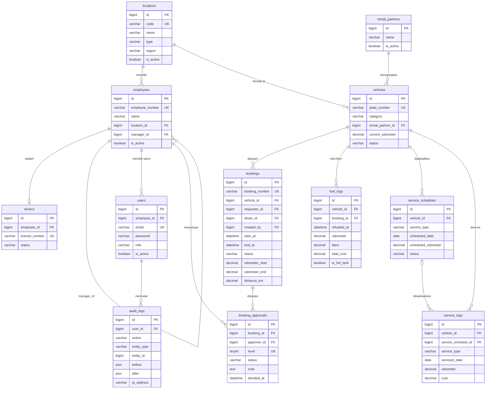

# Physical Data Model (ERD)
### TransOps — Fleet Booking & Monitoring System

| | |
|---|---|
| **Dokumen** | Physical Data Model (PDM) / ERD |
| **Versi** | 1.0 |
| **Tanggal** | 2026-08-04 |

---

## 1. Pendahuluan

### 1.1 Tujuan

Dokumen ini mendefinisikan struktur penyimpanan data TransOps — aplikasi pemesanan kendaraan beserta persetujuan berjenjang dan monitoring armada (konsumsi BBM, jadwal service, riwayat pemakaian) bagi perusahaan tambang nikel.

### 1.2 Ruang Lingkup

Mencakup 12 tabel database: master data, transaksi pemesanan, monitoring, dan sistem audit. Tidak mencakup kebijakan non-data seperti tata kelola aplikasi di luar skema penyimpanan.

### 1.3 Definisi

| Istilah | Makna |
|---|---|
| **Master** | Data acuan (lokasi, pegawai, driver, kendaraan, partner sewa). |
| **Transaksi** | Data operasional yang lahir dari proses pemesanan dan persetujuan. |
| **Monitoring** | Data pengukuran armada (BBM, service) yang berumbuh seiring waktu. |
| **Soft delete** | Penghapusan logis via kolom `deleted_at` (data tidak dihapus fisik). |

---

## 2. Konvensi & Prinsip Desain

### 2.1 Konvensi Tipe Data

- Primary key (PK) dan foreign key (FK) bertipe `BIGINT UNSIGNED`.
- Seluruh tabel memuat `created_at` / `updated_at` standar Laravel.
- Kolom `deleted_at` (soft delete) hanya diterapkan pada tabel master agar histori transaksional tidak terputus.
- Nilai kategori diskrit dijamin melalui `ENUM` pada lapisan database, bukan hanya validasi aplikasi.

### 2.2 Prinsip Desain

1. **Pemisahan domain** — master, transaksi, monitoring, dan audit dipisah agar siklus hidup data jelas.
2. **Normalisasi secukupnya** — menghindari FK redundan; index digunakan untuk efisiensi query.
3. **Satu sumber kebenaran** — `bookings.status` merupakan status agregat; detail per level disimpan terpisah di `booking_approvals`.
4. **Integritas di lapisan data** — unique constraint, FK, dan enum menjamin validitas di database.
5. **Denormalisasi terbatas** — hanya bila berdampak kinerja nyata, contoh: `current_odometer` pada `vehicles`.

---

## 3. Diagram Relasi



> Catatan: diagram di atas merangkum relasi inti. Spesifikasi kolom lengkap tersedia di Bagian 4.

---

## 4. Spesifikasi Physical Data Model

Struktur skema berikut merupakan sumber kebenaran implementasi (migrasi database).

### 4.1 `locations` — Lokasi Operasional

| Kolom | Tipe | Kunci/Aturan | Keterangan |
|---|---|---|---|
| id | BIGINT UNSIGNED | PK, Auto Increment | |
| code | VARCHAR(20) | UNIQUE | |
| name | VARCHAR(150) | NOT NULL | |
| type | ENUM('head_office','branch_office','mine') | | pusat / cabang / tambang |
| region | VARCHAR(100) | NULL | nama region/wilayah |
| address | VARCHAR(255) | NULL | |
| is_active | BOOLEAN | default 1 | |
| timestamps | | | + `deleted_at` |

### 4.2 `employees` — Pegawai

| Kolom | Tipe | Kunci/Aturan | Keterangan |
|---|---|---|---|
| id | BIGINT UNSIGNED | PK, Auto Increment | |
| employee_number | VARCHAR(30) | UNIQUE | NIK |
| name | VARCHAR(150) | NOT NULL | |
| position | VARCHAR(100) | | jabatan |
| department | VARCHAR(100) | | |
| email | VARCHAR(150) | NULL | |
| phone | VARCHAR(30) | NULL | |
| location_id | BIGINT UNSIGNED | FK → locations, NULL | |
| manager_id | BIGINT UNSIGNED | FK → employees, NULL | relasi diri sendiri; hierarki atasan untuk saran approver |
| is_active | BOOLEAN | default 1 | |
| timestamps | | | + `deleted_at` |

### 4.3 `drivers` — Driver (Subtype dari `employees`)

| Kolom | Tipe | Kunci/Aturan | Keterangan |
|---|---|---|---|
| id | BIGINT UNSIGNED | PK, Auto Increment | |
| employee_id | BIGINT UNSIGNED | FK → employees, UNIQUE, NOT NULL | 1:1, satu pegawai maksimal satu driver |
| license_number | VARCHAR(30) | UNIQUE | nomor SIM |
| license_type | VARCHAR(50) | NULL | |
| license_expiry | DATE | NULL | |
| status | ENUM('available','assigned','inactive') | default 'available' | |
| timestamps | | | + `deleted_at` |

### 4.4 `users` — Akun Login

Hanya menerima peran `admin` dan `approver`.

| Kolom | Tipe | Kunci/Aturan | Keterangan |
|---|---|---|---|
| id | BIGINT UNSIGNED | PK, Auto Increment | |
| employee_id | BIGINT UNSIGNED | FK → employees, UNIQUE, NULL | |
| username | VARCHAR(50) | UNIQUE, NOT NULL | |
| password | VARCHAR(255) | NOT NULL | bcrypt |
| role | ENUM('admin','approver') | | |
| is_active | BOOLEAN | default 1 | |
| last_login_at | DATETIME | NULL | |
| timestamps | | | |

### 4.5 `rental_partners` — Perusahaan Persewaan

| Kolom | Tipe | Kunci/Aturan | Keterangan |
|---|---|---|---|
| id | BIGINT UNSIGNED | PK, Auto Increment | |
| name | VARCHAR(150) | NOT NULL | |
| contact_person | VARCHAR(100) | NULL | |
| phone | VARCHAR(30) | NULL | |
| email | VARCHAR(150) | NULL | |
| address | VARCHAR(255) | NULL | |
| is_active | BOOLEAN | default 1 | |
| timestamps | | | + `deleted_at` |

### 4.6 `vehicles` — Kendaraan

| Kolom | Tipe | Kunci/Aturan | Keterangan |
|---|---|---|---|
| id | BIGINT UNSIGNED | PK, Auto Increment | |
| plate_number | VARCHAR(20) | UNIQUE | |
| category | ENUM('passenger','goods') | | angkut orang / barang |
| capacity | DECIMAL(8,2) | NULL | kursi atau tonase |
| brand | VARCHAR(50) | | |
| model | VARCHAR(50) | | |
| year | SMALLINT | NULL | |
| ownership_type | ENUM('company','rental') | | milik sendiri / sewa |
| rental_partner_id | BIGINT UNSIGNED | FK → rental_partners, NULL | hanya untuk kendaraan sewa |
| rental_start_date | DATE | NULL | |
| rental_end_date | DATE | NULL | |
| fuel_type | ENUM('diesel','petrol','electric') | | |
| tank_capacity | DECIMAL(6,2) | NULL | |
| current_odometer | DECIMAL(10,2) | default 0 | di-sinkron saat kendaraan kembali |
| status | ENUM('available','in_use','maintenance','retired') | default 'available' | |
| is_active | BOOLEAN | default 1 | |
| timestamps | | | + `deleted_at` |

### 4.7 `bookings` — Pemesanan (Rangkuman Riwayat Pemakaian)

| Kolom | Tipe | Kunci/Aturan | Keterangan |
|---|---|---|---|
| id | BIGINT UNSIGNED | PK, Auto Increment | |
| booking_number | VARCHAR(30) | UNIQUE, NOT NULL | format `BK-YYYYMM-NNNN` |
| vehicle_id | BIGINT UNSIGNED | FK → vehicles | |
| requester_id | BIGINT UNSIGNED | FK → employees | pegawai pemesan |
| driver_id | BIGINT UNSIGNED | FK → drivers | driver yang ditugaskan |
| purpose | TEXT | | keperluan |
| destination | VARCHAR(200) | | |
| start_at | DATETIME | | rencana berangkat |
| end_at | DATETIME | | rencana kembali |
| status | ENUM('pending','approved','rejected','cancelled','in_use','completed') | default 'pending' | |
| created_by | BIGINT UNSIGNED | FK → users | admin penginput |
| departure_at | DATETIME | NULL | berangkat aktual |
| return_at | DATETIME | NULL | kembali aktual |
| odometer_start | DECIMAL(10,2) | NULL | saat berangkat |
| odometer_end | DECIMAL(10,2) | NULL | saat kembali |
| distance_km | DECIMAL(10,2) | NULL | dihitung saat kembali |
| note | TEXT | NULL | |
| timestamps | | | |

### 4.8 `booking_approvals` — Persetujuan Berjenjang

| Kolom | Tipe | Kunci/Aturan | Keterangan |
|---|---|---|---|
| id | BIGINT UNSIGNED | PK, Auto Increment | |
| booking_id | BIGINT UNSIGNED | FK → bookings, CASCADE | |
| approver_id | BIGINT UNSIGNED | FK → employees | wajib memiliki akun role `approver` |
| level | TINYINT UNSIGNED | | 1, 2, 3, … |
| status | ENUM('pending','approved','rejected') | default 'pending' | |
| note | TEXT | NULL | |
| decided_at | DATETIME | NULL | |
| timestamps | | | |
| **UNIQUE** | `(booking_id, level)` | | satu level per pemesanan |

### 4.9 `fuel_logs` — Pencatatan BBM

| Kolom | Tipe | Kunci/Aturan | Keterangan |
|---|---|---|---|
| id | BIGINT UNSIGNED | PK, Auto Increment | |
| vehicle_id | BIGINT UNSIGNED | FK → vehicles | |
| booking_id | BIGINT UNSIGNED | FK → bookings, NULL | pengisian terkait perjalanan |
| recorded_by | BIGINT UNSIGNED | FK → employees, NULL | |
| refueled_at | DATETIME | | |
| odometer | DECIMAL(10,2) | | |
| liters | DECIMAL(10,2) | | |
| price_per_liter | DECIMAL(12,2) | | |
| total_cost | DECIMAL(12,2) | | `liters × price_per_liter` |
| station | VARCHAR(100) | NULL | |
| is_full_tank | BOOLEAN | default 1 | dasar perhitungan km/liter |
| note | TEXT | NULL | |
| timestamps | | | |

### 4.10 `service_schedules` — Jadwal Service (Mutabel)

| Kolom | Tipe | Kunci/Aturan | Keterangan |
|---|---|---|---|
| id | BIGINT UNSIGNED | PK, Auto Increment | |
| vehicle_id | BIGINT UNSIGNED | FK → vehicles | |
| service_type | VARCHAR(50) | | oil_change, routine, brake, dll |
| scheduled_date | DATE | NULL | rencana pelaksanaan |
| scheduled_odometer | DECIMAL(10,2) | NULL | |
| recurrence_km | INT | NULL | interval km |
| recurrence_months | INT | NULL | interval bulan |
| status | ENUM('scheduled','due','overdue','cancelled') | default 'scheduled' | |
| note | TEXT | NULL | |
| timestamps | | | |

### 4.11 `service_logs` — Riwayat Service (Immutable)

| Kolom | Tipe | Kunci/Aturan | Keterangan |
|---|---|---|---|
| id | BIGINT UNSIGNED | PK, Auto Increment | |
| vehicle_id | BIGINT UNSIGNED | FK → vehicles | |
| service_schedule_id | BIGINT UNSIGNED | FK → service_schedules, NULL | NULL untuk perbaikan ad-hoc/breakdown |
| service_type | VARCHAR(50) | | |
| serviced_date | DATE | | |
| odometer | DECIMAL(10,2) | | |
| cost | DECIMAL(12,2) | NULL | |
| vendor | VARCHAR(150) | NULL | |
| mechanic | VARCHAR(100) | NULL | |
| note | TEXT | NULL | |
| timestamps | | | |

### 4.12 `audit_logs` — Log Aplikasi

| Kolom | Tipe | Kunci/Aturan | Keterangan |
|---|---|---|---|
| id | BIGINT UNSIGNED | PK, Auto Increment | |
| user_id | BIGINT UNSIGNED | FK → users, NULL, SET NULL | |
| action | VARCHAR(50) | NOT NULL | `booking.created`, `booking.approved`, dll |
| entity_type | VARCHAR(50) | | |
| entity_id | BIGINT UNSIGNED | NULL | |
| before | JSON | NULL | data sebelum |
| after | JSON | NULL | data sesudah |
| ip_address | VARCHAR(45) | NULL | |
| user_agent | VARCHAR(255) | NULL | |
| created_at | | | tanpa `updated_at` (log immutable) |

---

## 5. State Machine `bookings`

```
pending ──(semua level disetujui)──▶ approved ──(penggunaan dimulai)──▶ in_use ──(kembali)──▶ completed
   │                                      │
   ├──(ada level ditolak)──▶ rejected     └──(admin)──▶ cancelled
   └──(admin)──▶ cancelled
```

## 6. Aturan Data

- Wajib minimal 2 level persetujuan saat pemesanan dibuat.
- Approver terpilih harus memiliki akun role `approver`.
- Persetujuan bersifat berurutan: level N hanya dapat diproses bila level N-1 telah disetujui.
- Double-booking ditolak: kendaraan tidak boleh memiliki pemesanan `pending`/`approved`/`in_use` pada rentang waktu yang bertabrakan.
- Driver terpilih harus terdaftar pada `drivers` (status aktif) dan tidak memiliki aktivitas aktif bersamaan.
- Odometer awal/akhir wajib terisi saat penggunaan dibuka/ditutup agar perhitungan BBM (km/liter) valid.
- `audit_logs` dicatat pada setiap proses (create, update, approve, reject, cancel).
